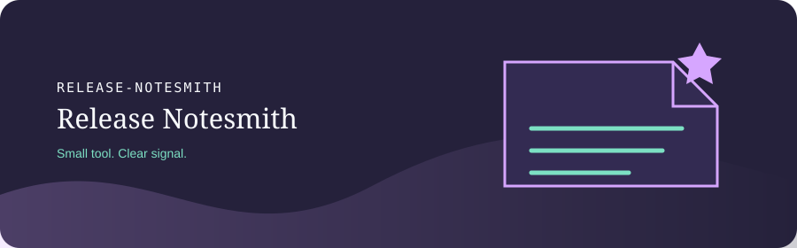

<div align="center">



# Release Notesmith

**A tiny changelog composer for repositories that use Conventional Commits.**

[](https://www.python.org/) [](LICENSE)

</div>

## Why it exists

Turn terse Conventional Commit subjects into a release note draft people can scan. Groups conventional commit subjects into feature, fix, performance and maintenance sections. It does not infer issue links, author attribution or semantic-version bumps; include only commit subjects you have reviewed.

## Features

- Conventional Commit type and scope parsing
- Breaking-change marker recognition
- Stable section ordering
- Markdown output suitable for a release draft

## Quick start

Python 3.10+; no third-party packages.

```bash
git clone https://github.com/MofidChallenge10/release-notesmith.git
cd release-notesmith
python tool.py --help
```

### Example

```bash
python tool.py --from-file commits.txt
```

## Self-test

```bash
python tool.py --self-test
```

The self-test uses the standard-library `unittest` module. Network-based tools do not contact external services during self-test.

## Scope and safety

Groups conventional commit subjects into feature, fix, performance and maintenance sections. It does not infer issue links, author attribution or semantic-version bumps; include only commit subjects you have reviewed. Review output before using it in production workflows.

## Design notes

The illustration is an original lightweight SVG. Motion is decorative and stops when `prefers-reduced-motion` is enabled; CLI output remains plain and pipe-friendly.

## Contributing

Issues and pull requests are welcome. Keep dependencies minimal, add focused tests for behavior changes, and update examples when options change.

## License

MIT — see [LICENSE](LICENSE).
